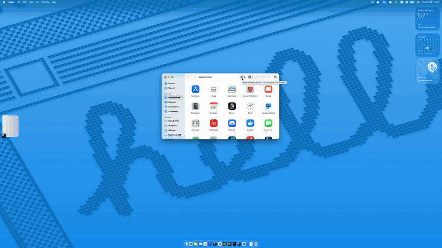

# mac-fancy-zones



[Full-quality video](docs/demo.mp4)

## What it does
Menu-bar macOS window manager with snap zones. **Edit Zones…** (menu bar icon) lets you draw zones on a 12×12 grid and set the gap between zones plus a Stage Manager left inset, all on one screen.
Drag a window by its title bar holding **Shift**: zones appear behind it, drop to snap (animated). Add **Ctrl** to span several zones.

## Build & install
```sh
./build.sh
```
Builds, signs with a local certificate (created once), installs to `~/Applications`, and launches. On first run grant Accessibility (System Settings → Privacy & Security), then relaunch. Needs the Swift toolchain (Command Line Tools). Checks: `swift run CoreChecks`.

## Tech & architecture
Swift + AppKit, SwiftPM, no dependencies, macOS 13+.
- `FancyZonesCore`: pure logic (zones, config JSON, geometry, easing), tested by `CoreChecks` (no XCTest with CLT only).
- `MacFancyZones`: menu-bar app. Global mouse monitors arm a title-bar drag; a 60 Hz poll reads Shift/Ctrl; windows move via the Accessibility API; a click-through overlay is ordered just below the dragged window.
- Config: `~/Library/Application Support/mac-fancy-zones/config.json`.
